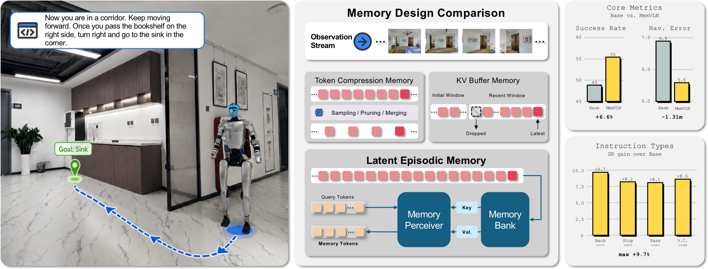
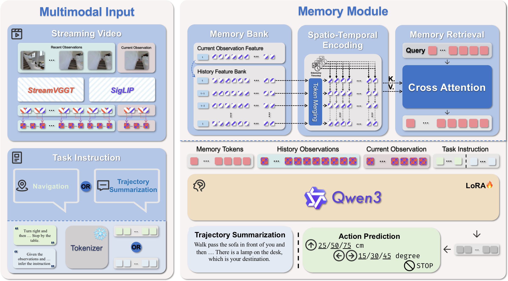
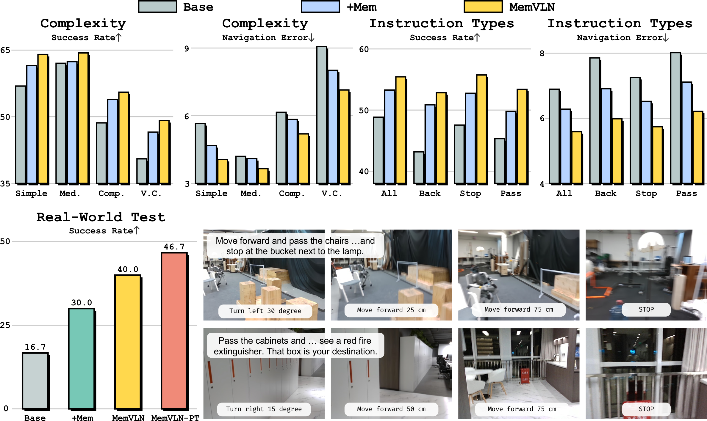

<div align="center">

# MemVLN: Streaming Episodic Memory for Vision-Language Navigation

**Persistent, compact navigation memory for monocular streaming video**

**Project page · Paper · Supplement — coming soon**

</div>

> The project-page repository is prepared but not publicly deployed. Release
> links will be enabled only after the project name and review-period release
> policy are finalized.

<p align="center">
  
</p>

MemVLN is a streaming episodic memory framework for vision-language
navigation. It augments a VLM navigator with a bounded memory bank that stores
compressed perceptual features together with temporal and odometric context.
A memory perceiver retrieves a fixed number of memory tokens, allowing the
policy to combine long-horizon route history with the current observation and
local visual context.

The current implementation uses Qwen3-VL-4B as the VLM, StreamVGGT as the
geometry encoder, and a trainable memory module with trajectory-summary
supervision.

## Highlights

- **Streaming episodic memory.** Navigation observations are progressively
  written to a persistent episode-level memory bank.
- **Bounded history.** Similar consecutive frames and spatial tokens are
  consolidated to keep memory cost controlled over long trajectories.
- **Spatio-temporal retrieval.** Fourier position features, temporal
  embeddings, and cross-attention produce 300 compact memory tokens.
- **Memory-focused supervision.** Navigation training is combined with masked,
  multi-granularity trajectory summarization derived from the same R2R and RxR
  demonstrations.
- **Simulation and real-world evaluation.** The manuscript evaluates MemVLN on
  R2R/RxR VLN-CE and on a Unitree G1 robot.

## Method

<p align="center">
  
</p>

At every navigation step, MemVLN:

1. encodes the current RGB observation and geometry-aware StreamVGGT features;
2. appends the observation feature, timestep, and accumulated odometry to the
   episode memory;
3. consolidates the memory when its capacity is reached; and
4. retrieves memory tokens that condition autoregressive action generation.

The default action space is `STOP`, `MOVE_FORWARD`, `TURN_LEFT`, and
`TURN_RIGHT`. Consecutive actions are merged into short text commands during
training and expanded back into atomic Habitat actions during evaluation.

## Results reported in the current manuscript

The following numbers are manuscript results, not metrics regenerated by the
lightweight unit-test suite in this repository.

| Dataset | Split | NE ↓ | OSR ↑ | SR ↑ | SPL ↑ | nDTW ↑ |
| --- | --- | ---: | ---: | ---: | ---: | ---: |
| R2R VLN-CE | Val-Unseen | 5.19 | 61.2 | 55.0 | 50.5 | — |
| RxR VLN-CE | Val-Unseen | 5.59 | — | 55.4 | 48.4 | 64.6 |

The navigation model is trained on the official R2R and RxR training
trajectories: 10,819 R2R demonstrations and 19,996 RxR demonstrations.
R2R sub-trajectory supervision additionally uses the
[FGR2R fine-grained annotations](https://github.com/YicongHong/Fine-Grained-R2R),
which align sub-instructions with intermediate waypoints on the original R2R
routes. “No external navigation trajectories” does not mean training from
scratch: the model still uses pretrained Qwen3-VL and StreamVGGT weights.

For the real-world study, each variant is evaluated on six held-out
instructions with five runs per instruction:

| Method | Runs | Successes | SR ↑ | Collision rate ↓ |
| --- | ---: | ---: | ---: | ---: |
| Base VLM | 30 | 5 | 16.7 | 56.7 |
| + Memory | 30 | 9 | 30.0 | 66.7 |
| MemVLN | 30 | 12 | 40.0 | 46.7 |
| MemVLN-PT (24 demonstrations) | 30 | 14 | 46.7 | 46.7 |

<p align="center">
  
</p>

## Release status

| Artifact | Status |
| --- | --- |
| Training and evaluation code | Available in this repository |
| Real-world G1/Go2 deployment code | Available under `realworld/` |
| Project page | Prepared; public deployment pending |
| Paper and supplement | Public links pending |
| Trained checkpoints and processed annotations | Release pending |

## Installation

The April W&B metadata records Python 3.9.23; the code targets Habitat 0.2.4.
Known direct Python dependencies are pinned in `requirements.txt`. Install a
PyTorch build compatible with the CUDA driver on your machine before compiling
FlashAttention.

```bash
git clone https://github.com/MemVLN/MemVLN.git
cd MemVLN

conda create -n memvln python=3.9 ffmpeg=4.4 -c conda-forge
conda activate memvln

# PyTorch reference setup; change the CUDA wheel if required by your machine.
pip install torch==2.6.0 torchvision==0.21.0 torchaudio==2.6.0 \
  --index-url https://download.pytorch.org/whl/cu118

# Habitat-Sim and Habitat-Lab 0.2.4.
conda install habitat-sim==0.2.4 headless withbullet \
  -c conda-forge -c aihabitat
git clone --branch v0.2.4 https://github.com/facebookresearch/habitat-lab.git
pip install -e habitat-lab/habitat-lab
pip install -e habitat-lab/habitat-baselines

pip install -r requirements.txt
pip install flash-attn==2.7.4.post1 --no-build-isolation
```

The exact April training environment was not fully preserved. The model and
training settings are recovered, while PyTorch/CUDA/FlashAttention builds
should be recorded alongside new reproduction runs.

## Pretrained models

Download:

- [Qwen3-VL-4B-Instruct](https://huggingface.co/Qwen/Qwen3-VL-4B-Instruct)
- [StreamVGGT](https://github.com/wzzheng/StreamVGGT)

The April run used a checkpoint named `StreamVGGT-1B.pth`. This repository's
loader expects a PyTorch state dict and that exact artifact should be reused
for controlled reproduction. The upstream public repository currently
publishes differently named artifacts; substituting one has not yet been
validated for checkpoint-key parity.

Pass local paths with Hydra overrides:

```text
llm.cfg_path=/path/to/Qwen3-VL-4B-Instruct
vision3d.ckpt_path=/path/to/the-April-StreamVGGT-1B.pth
```

## Data

MemVLN uses [R2R](https://bringmeaspoon.org/),
[RxR](https://github.com/google-research-datasets/RxR), and
[Matterport3D](https://github.com/niessner/Matterport). Obtain the datasets
from their official sources and follow their licenses and access terms.

The cached training observations and annotations are read from
`${data.annotation_base}/vln`:

```text
${annotation_base}/vln/
├── r2r/
│   └── train/
│       ├── train_sub.json       # April recipe: R2R + FGR2R alignment
│       ├── train.json.gz        # fallback without sub-trajectory supervision
│       ├── train_gt.json.gz
│       └── traj/
│           └── <trajectory_id>/
│               └── <frame_id>.png
└── rxr/
    └── train_v2/
        ├── annotations.json
        └── <trajectory_id>/
            └── rgb/
                └── <frame_id>.jpg
```

Set the root at launch time:

```text
data.annotation_base=/path/to/annotations
```

Habitat evaluation additionally requires the Matterport3D scenes and the R2R
or RxR VLN-CE episode files. Update `habitat.dataset.scenes_dir` and
`habitat.dataset.data_path` in:

- `configs/habitat/r2r.yaml`
- `configs/habitat/rxr.yaml`

The April cache-generation pipeline and redistributable annotation manifest are
not yet complete in this repository. Matterport3D RGB observations must be
generated locally by users who have accepted the dataset terms; they should
not be redistributed as part of the processed-annotation release.

Safe inspection/conversion utilities currently included:

```bash
# Convert an RxR guide split to the R2R-compatible English evaluation schema.
python habitat_extensions/rxr_conversion.py \
  /path/to/train_guide.json.gz \
  /path/to/train_guide_en.json.gz \
  --language en

# Inspect action and sequence lengths before changing context limits.
python habitat_extensions/stat_vln_action_lengths.py \
  --anno-dir /path/to/annotations/vln \
  --split train \
  --datasets r2r rxr
```

Run each utility with `--help` for its complete contract. Existing outputs are
not overwritten unless `--overwrite` is explicitly passed.

## April checkpoint configuration in the current code

The composed default translates the settings stored beside the April
checkpoint into the cleaned codebase. These fields are directly supported by
the saved config:

| Checkpoint-attached setting | Value |
| --- | --- |
| Task mixture | R2R + RxR-v2 navigation and trajectory summarization |
| GPUs | 8 |
| Per-GPU batch size | 1 |
| Gradient accumulation | 1 |
| Epochs | 1 |
| Learning rate | `2e-5` |
| Memory tokens | 300 |
| Observation history | nearest 16 frames |
| Prompt format | v2 with memory prompt |
| StreamVGGT cached features | enabled |

The cleaned implementation also applies these explicit current policies:

| Current policy | Default |
| --- | --- |
| Memory-module parameter dtype | BF16 |
| Checkpoints retained | 5 |
| Optimized evaluation pipeline | enabled |

The BF16 memory option and five-checkpoint retention are current,
reproduction-oriented defaults; they were not standalone keys in the saved
April config. A new run is therefore a controlled reproduction attempt, not a
claim that the manuscript result has already been regenerated.

Launch a current eight-GPU reproduction run:

The safe default below keeps W&B disabled. To log online, set
`WANDB_MODE=online` and explicitly add `logger.entity=<your-entity>`.

```bash
RUN_NOTE=memvln_april_recipe

WANDB_MODE=disabled HYDRA_FULL_ERROR=1 \
python launch.py \
  --mode accelerate \
  --strategy ddp \
  --gpu_per_node 8 \
  --cpu_per_task 16 \
  --port 3012 \
  '~task.vlnce' \
  llm.cfg_path=/path/to/Qwen3-VL-4B-Instruct \
  vision3d.ckpt_path=/path/to/the-April-StreamVGGT-1B.pth \
  data.annotation_base=/path/to/annotations \
  base_dir=/path/to/outputs \
  note="$RUN_NOTE"
```

`~task.vlnce` disables Habitat rollout during training, which is useful on
machines without an NVIDIA EGL/OpenGL evaluation environment. It does not
change the model or training loss.

`data.annotation_base` must point to the parent of the `vln/` directory. For
example, when the data lives at `/workspace/data/leo2_data/vln`, set
`data.annotation_base=/workspace/data/leo2_data` because the config appends
`/vln`.

Do not carry forward the obsolete
`task.training.repa_loss_weight=0` override from intermediate LEO-R commands.
That component and config field are absent in the cleaned training path; the
zero-valued override had no role in the April checkpoint recipe.

### Memory-module parameter dtype

The memory-module parameter and floating-buffer dtype is independently
configurable:

```text
llm.mem_module.param_dtype=bf16   # current reproduction default
llm.mem_module.param_dtype=fp32   # explicit FP32 ablation
llm.mem_module.param_dtype=fp16   # explicit FP16 ablation
```

Only memory-module parameters and floating-point buffers are converted. LoRA
and StreamVGGT merger parameters retain their own construction dtypes.

### Checkpoint retention

`training.checkpoint_total_limit` controls Accelerate's automatic checkpoint
retention and defaults to 5. Checkpoint directories use the full numeric
suffix, for example `checkpoint_9`, `checkpoint_10`, and `checkpoint_33`.

The main trainer accepts an exact model file, a checkpoint directory
containing exactly one of the files below, an Accelerate `checkpoints/`
directory, or an experiment root containing `checkpoints/`:

```text
model.safetensors
pytorch_model.bin
```

For the latter two forms it selects the largest full numeric checkpoint
suffix. For example, passing the recovered `best/best` experiment root selects
`checkpoints/checkpoint_33/model.safetensors`.

Full-state mid-epoch resume with the custom streaming sampler is not claimed
to be bit-exact because sampler progress and episode memory are not fully
contained in the checkpoint. Use released checkpoints for evaluation or
model-only initialization unless a run was saved at an epoch boundary.

## Current-code evaluation

The split evaluator runs independent Habitat shards on multiple GPUs. It uses
the optimized inference pipeline by default, as a current project policy:

```yaml
inference:
  cache_grounded_memory: true
  skip_memory_attention_weights: true
  fast_habitat: true
```

These flags do not affect the training forward pass. The optimized evaluator
is not expected to be bit-identical to the historical April evaluator. For a
formal parity audit, compare both the complete benchmark metrics and
per-episode generated text/atomic action traces; an aggregate match alone
cannot establish trajectory parity.

Run a current-code R2R Val-Unseen evaluation on eight GPUs:

```bash
bash split_eval/launch_eval_split.sh \
  --gpus 8 \
  --model /path/to/checkpoint/model.safetensors \
  --epoch 0 \
  base_dir=/path/to/eval_outputs \
  llm.cfg_path=/path/to/Qwen3-VL-4B-Instruct \
  vision3d.ckpt_path=/path/to/the-April-StreamVGGT-1B.pth \
  '~task.vlnce.RxR'
```

For RxR, remove R2R instead:

```text
~task.vlnce.R2R
```

Merge shard outputs:

```bash
python split_eval/merge_results.py \
  --dir /path/to/eval_outputs/Qwen3-VLNCE_<note>/eval_results/R2R/epoch_0 \
  --expected-splits 8
```

When the expected number of unique benchmark episodes is known, also pass
`--expected-episodes <N>` so missing episodes cannot be hidden by otherwise
well-formed shard files.

The split evaluator currently expects the exact checkpoint file path rather
than a checkpoint directory. It loads non-strictly for legacy compatibility,
so inspect every reported missing/unexpected key. Strict active-key checkpoint
validation remains future work.

## Real-world deployment

The manuscript evaluates MemVLN on Unitree G1. The repository also contains an
experimental Go2 client. See [realworld/readme.md](realworld/readme.md) for the
inference server, camera/odometry interfaces, and robot-side commands.

Real-robot execution requires an operator-controlled emergency stop and a
clear operating area. The current post-training result improves task success
but does not reduce the reported collision rate relative to MemVLN.

## Repository structure

```text
configs/                  Hydra training, model, data, and Habitat configs
data/                     R2R/RxR datasets, collation, and streaming sampler
model/memory/             Episodic memory bank, retrieval, and consolidation
model/streamvggt/         Streaming geometry encoder integration
model/qwen/               Qwen3-VL navigation and memory integration
trainer/                  SFT training and checkpoint management
evaluator/                Habitat VLN-CE evaluators
split_eval/               Multi-GPU sharded evaluation and result merging
realworld/                G1/Go2 server and robot clients
tests/                    Lightweight regression and contract tests
```

## Tests

The test suite does not require Matterport3D or a full Habitat rollout:

```bash
PYTHONDONTWRITEBYTECODE=1 \
python -m unittest discover -s tests -p 'test_*.py'
```

Full reproduction additionally requires model loading, one-batch training
checks, and complete R2R/RxR VLN-CE evaluation.

## Limitations

- Similarity-based memory consolidation can discard observations that later
  become relevant.
- The current memory supervision is centered on trajectory summarization;
  broader memory-centric objectives remain open.
- Real-world collision avoidance and fine-grained landmark grounding remain
  significant limitations.
- The exact historical software build was not fully preserved, so new runs
  should record PyTorch, CUDA, FlashAttention, base-model revisions, data
  hashes, and the resolved Hydra config.

## Citation

Public author and venue metadata will be added with the paper release. Until
then, please refer to the work by its title:

```text
MemVLN: Streaming Episodic Memory for Vision-Language Navigation
```

## Acknowledgements

This codebase builds on
[LEO](https://github.com/embodied-generalist/embodied-generalist),
[Qwen3-VL](https://huggingface.co/Qwen/Qwen3-VL-4B-Instruct),
[StreamVGGT](https://github.com/wzzheng/StreamVGGT),
[Habitat-Lab](https://github.com/facebookresearch/habitat-lab), R2R, FGR2R,
and RxR.
Please follow the licenses and terms of each upstream project and dataset.

## License

See [LICENSE](LICENSE) for the inherited LEO code license. Third-party model
and simulator components retain their respective upstream licenses and
notices. The vendored StreamVGGT licensing/notice boundary must be resolved
before a public source release.
